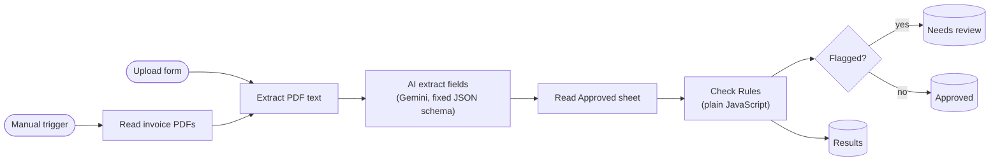

# Invoice checker with human review (n8n + Gemini)

An n8n workflow that reads supplier invoice PDFs, uses AI to copy out the key fields, checks them
with plain-code rules, and sends anything suspicious to a person for review.

> **All data in this repo is synthetic.** The invoices, companies and amounts are generated by
> `tools/make_invoices.py`. The results below come from testing on **50 synthetic invoices**, not
> real ones.

## What it does

For each invoice PDF, the workflow:

1. Extracts the text from the PDF.
2. Asks Gemini to copy out the vendor, invoice number, date, line items, subtotal, tax and total
   into a fixed JSON schema. The AI only copies values. It never decides pass or fail.
3. Runs rule checks in plain JavaScript (`src/rules.js`):
   - each line: quantity x unit price = amount
   - lines add up to the subtotal
   - tax is 6% of the subtotal
   - subtotal + tax = total
   - invoice number is present and looks like `INV-` plus digits
   - date is real and not in the future
   - no required field is missing
   - not a duplicate of an invoice already approved
4. Appends clean invoices to the **Approved** sheet, flagged ones to **Needs review** (with the
   reasons and blank columns for the reviewer's decision), and every invoice to **Results**.

There are two workflows:

| Workflow | Starts from | Use |
|---|---|---|
| `workflows/invoice-checker-batch.json` | Manual trigger, reads every PDF in a folder | Batch runs and the evaluation |
| `workflows/invoice-checker-demo-form.json` | n8n form with one PDF upload field | Demo: upload one invoice, see where it lands |

## How it works



The AI extracts, the code decides, and a person reviews anything flagged. Node-by-node details
and design decisions are in [docs/architecture.md](docs/architecture.md).

## Results (50 synthetic invoices)

Measured with `tools/evaluate.py` against `data/ground_truth.csv`, using Gemini 3.5 Flash-Lite at
temperature 0 and n8n 2.46.6.

| Metric | Result |
|---|---|
| Field accuracy (vendor, number, date, subtotal, tax, total) | **300 / 300** (100%) |
| Planted errors caught | **10 / 10** |
| False alarms on clean invoices | **0 / 40** |
| Time per invoice | 10.3 s, including a deliberate 4.5 s pause to stay under the free-tier rate limit |
| Tokens per invoice | 1,086 on average (865 input, 220 output) |
| Cost per invoice | $0 on the free tier; $0.00081 at the paid list price ($0.30 / 1M input, $2.50 / 1M output tokens, November 2026) |

| Planted error | Caught |
|---|---|
| Wrong tax | 2 / 2 |
| Wrong total | 2 / 2 |
| Impossible date (`2026-13-45`) | 2 / 2 |
| Duplicate invoice number (same vendor) | 2 / 2 |
| Missing invoice number | 2 / 2 |

Token counts come from Gemini's own usage figures, logged by n8n for each call, and match the
Google AI Studio usage page.

## What it gets wrong

- **The test is easy.** All 50 invoices share one layout, are text PDFs, and were generated by
  this project. A perfect score here does not mean a perfect score on real invoices. Measure on a
  sample of real invoices before relying on it.
- **Misreads that keep the numbers consistent are not caught.** The rules catch an AI misread when
  the arithmetic stops adding up. A wrong vendor name or invoice number passes the arithmetic, so it
  could let a duplicate through.
- **No scanned invoices.** Text is read straight from the PDF. Image-only scans would need OCR
  first. Multi-page invoices were not tested.
- **Reviewer decisions are not fed back.** If a person approves an invoice from Needs review, the
  workflow does not add it to Approved, so a later copy of it would not be caught as a duplicate.
- **Simple rules.** One flat tax rate, the `INV-` number format of the synthetic suppliers,
  duplicates matched on vendor + number only, and dates only in `YYYY-MM-DD`. The full list is in
  [docs/limitations.md](docs/limitations.md).
- **Free-tier speed.** At the time of testing, Gemini's free tier allowed 15 requests per minute
  and 500 per day for this model. In the 50-invoice run, one call took 132.6 s, which stretched the run to 8.5 minutes.
- **Google Sheets is not a database.** Two runs at the same time could both approve the same
  duplicate. Run one batch at a time.

## Safety notes

- **Synthetic data only.** No real invoices, people or companies.
- **The AI never decides pass or fail.** All decisions are in `src/rules.js`, covered by 58 unit
  tests.
- **No sending, replying or deleting.** The workflows only read PDFs and append rows to a sheet.
- **Local only.** n8n listens on `127.0.0.1` and may only read files from the invoices folder.
- **No secrets in the repo.** Credentials stay in n8n's encrypted store. Exported workflows are
  cleaned by `tools/sanitize_workflow.py`, which removes credentials, IDs, the sheet ID and
  personal details.
- **Data use.** On Gemini's free tier, Google may use the inputs to improve its products. For real
  invoices, use the paid tier, where inputs are not used that way, and check the client's own data
  rules.

## Run it yourself

You need Node.js 24 or newer (required by n8n 2.46.6), Python 3.11 or newer, a Google account,
and a Gemini API key from Google AI Studio. Commands below are for Windows PowerShell.

1. **Tests and invoices.** Run the rule tests with `node --test`. The 50 PDFs are already in
   `invoices/`. To regenerate them (the seed and dates are fixed, so the data comes out the same):
   ```powershell
   python -m venv .venv
   .venv\Scripts\pip install fpdf2==2.9.0
   .venv\Scripts\python tools\make_invoices.py
   ```
2. **Start n8n on localhost only**, limited to the invoices folder:
   ```powershell
   $env:N8N_LISTEN_ADDRESS = '127.0.0.1'
   $env:N8N_RESTRICT_FILE_ACCESS_TO = 'C:\full\path\to\invoice-checker\invoices'
   npx n8n@2.46.6
   ```
   Then open http://localhost:5678. n8n blocks file reads outside this folder, so the path in
   step 5 must point inside it.
3. **Create a Google Sheet** called `Invoice results` with three tabs and these header rows:
   - `Approved`: `processed_at, file, vendor, invoice_no, date, subtotal, tax, total`
   - `Needs review`: the same, plus `reasons, reviewer_decision, reviewer_notes`
   - `Results`: the same as Approved, plus `flagged, reasons`
4. **Add two credentials in n8n:**
   - **Google Sheets OAuth2 API.** In Google Cloud: create a project, enable the Google Sheets and
     Google Drive APIs, set the OAuth consent screen to **External** in **Testing** mode and add
     your own Google account as a **test user**, then create an OAuth client of type
     "Web application" with the redirect URL
     `http://localhost:5678/rest/oauth2-credential/callback`. Paste its client ID and secret into
     n8n and sign in. In Testing mode the sign-in expires after 7 days; reconnect it in n8n when it
     does.
   - **Google Gemini(PaLM) Api**, with an API key from Google AI Studio.
5. **Import both workflows.** Create a new workflow, then use the **⋯** menu at the top right and
   choose **Import from File**. The import brings in the nodes but not the workflow description.
   In each imported workflow:
   - choose your credentials on the `Gemini` node and on every Google Sheets node,
   - in every Google Sheets node, replace `YOUR_SPREADSHEET_ID` with your sheet's ID (the long
     part of its URL between `/d/` and `/edit`). Changing the document **clears the Sheet field and
     the node's options**, so then:
     - pick the tab again under **Sheet** (From list): `Approved`, `Needs review` or `Results`,
       matching the node's name,
     - in the three `Add to …` nodes, add the two options again: **Cell Format: Let n8n format**
       and **Handling extra fields in input: Ignore Them**. Without them, extra fields become new
       columns in your sheet,
   - in the batch workflow, replace the whole path in `Read invoice PDFs`, including the
     `C:/CHANGE-ME` part, with your `invoices` folder in forward slashes, for example
     `C:/Users/you/invoice-checker/invoices/invoice_*.pdf`.
6. **Run the batch workflow**, then download the Results tab as CSV to `data/results_export.csv`
   and score it:
   ```powershell
   .venv\Scripts\python tools\evaluate.py data\results_export.csv --run-seconds <seconds> --tokens <total tokens>
   ```
   Take the run time from n8n's Executions list and the token total from Google AI Studio's
   usage page. Clear the data rows (keep the headers) before each new run. Otherwise every invoice
   already in Approved is flagged as a duplicate.
7. **Try the demo:** clear the sheet rows first, for the same reason. Then open the demo workflow,
   click **Execute workflow**, and upload one PDF in the form that opens.

## Repo layout

```
src/rules.js                  checking rules, one pure function
test/rules.test.js            58 unit tests (node --test)
tools/make_invoices.py        generates the 50 synthetic invoices and ground truth
tools/evaluate.py             scores a Results export against ground truth
tools/sanitize_workflow.py    strips credentials, IDs and personal details from an n8n export
data/ground_truth.csv         what is printed on each invoice, and its planted error
data/results_export.csv       Results tab from the 50-invoice run
workflows/                    the two n8n workflows, sanitized
invoices/                     the 50 synthetic PDFs
docs/                         architecture and limitations
```
